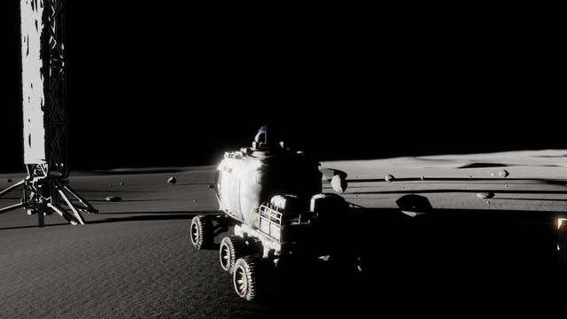
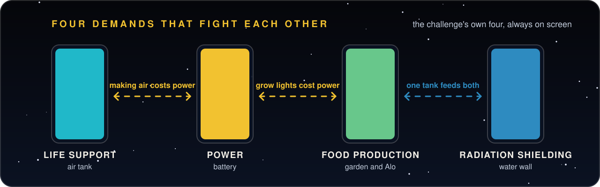
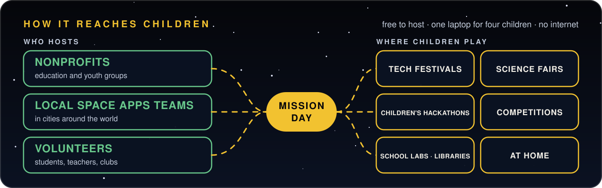

<div align="center">



<br><br>


**[Play it](https://github.com/SadManQT/last-light-academy/releases)** &nbsp;·&nbsp; **[Science and data](docs/SCIENCE_AND_DATA.md)** &nbsp;·&nbsp; **[Classroom kit](docs/classroom/README.md)** &nbsp;·&nbsp; **[AI use](docs/AI_USE.md)** &nbsp;·&nbsp; **[Credits](CREDITS.md)**

Challenge: **[Build a Junior Astronaut Mission Trainer](https://www.spaceappschallenge.org/2026/challenges/build-a-junior-astronaut-mission-trainer/)** &nbsp;·&nbsp; Team **The Last BrainCell** &nbsp;·&nbsp; Dhaka, Bangladesh

*An independent student project. It is not endorsed by NASA and uses no NASA logos.*

<br>



</div>

| | |
|---|---|
| **240-second video** | *link added after upload* |
| **30-second video** | *link added after upload* |
| **Play it** | [Windows and macOS builds](https://github.com/SadManQT/last-light-academy/releases) |
| **Project page text** | [docs/SUBMISSION.md](docs/SUBMISSION.md) |

---

## The game in numbers



Every figure is counted from this repository. The story is in [`full-game-story/`](full-game-story/), the puzzles in [`game-design/08_PUZZLE_DESIGNS.md`](game-design/08_PUZZLE_DESIGNS.md), the data in [`game/resources/data/nasa/`](game/resources/data/nasa/) and the tests in [`game/tools/`](game/tools/).

## The problem

Ask a seven-year-old what they want to be and someone always says *astronaut*. By fifteen, that answer is gone.

In rich countries children learn space by doing: simulators, VR, astronaut camp. One week of Space Camp costs about 1,800 US dollars. In countries like ours there is none of this, and two in three school-age children in the world have no internet at home. So space arrives as one page of theory. The page is either too hard or too simple, and it never shows the real difficulty: the things a crew needs **fight each other**. The power that warms the crew is the power that makes their air. The water that shields them from a solar storm is the water the plants drink.

A child who never makes one of those decisions never finds out what NASA really does.

## Our answer

**Last Light Academy** is a free, offline 3D mission trainer for ages 10 to 15. You and up to three friends run Aurora Station at the Moon's south pole. The Sun sets for 36 hours. You plan the night shift by shift, try each plan before you lock it in, and then live with the result.

1. **Four players, one laptop, no internet.** In Class mode each cadet holds facts the others need, and a decision locks in only when all four sign it. A whole class can run a mission in one lesson in a school computer lab.
2. **Real history, replayed.** The storm that hits the base is the real solar storm of 10 September 2017, with its real 70 minutes of warning.
3. **Every number shows where it came from.** Data Cards name the source and label each value *Observed*, *Computed* or *Training assumption*, so learners practise asking "how do we know?"
4. **Something living to protect.** Alo is *Brassica rapa*, the mustard grown in Bangladesh every winter. Children protect what they love, so every choice shows on her: she wilts, survives or blooms.
5. **A science film as the hint.** Every mission has a short narrated film, built from the same data, for the moment a player is stuck.

| The Mission Table: plan, try it, lock it in | A Data Card: the source behind a number |
|---|---|
|  |  |

## Four demands that fight each other

The challenge asks for a game in which students *"run a lunar or Martian outpost, balancing competing demands like life support, radiation shielding, power, and food production"*. Those four demands are always on screen.



| Demand | What the player manages | Real data behind it |
|---|---|---|
| **Life support** | An air tank of 10 units. Four crew breathe 1 unit per shift. Making air costs power. | NASA Life Support Baseline Values (BVAD, 2022): 0.895 kg of oxygen per person per day |
| **Radiation shielding** | A water wall plus supply boxes. At the storm alarm: pump water, stack boxes, or wait. | NASA DONKI and NOAA GOES-13 records of the 10 Sep 2017 storm; NASA Langley shielding studies (20 g/cm² of water) |
| **Power** | A battery of 20 units. Sunlight adds 8 per shift by day and nothing at night. | NASA Langley 10 kW south-pole solar array study; LRO LOLA illumination study; JPL Horizons |
| **Food production** | The garden, rations and Alo. Light costs power. Water is shared with the shield. | NASA BVAD food rates; NASA OSDR *Brassica rapa* on the ISS; seed-to-seed growth on Mir |

## Eight chapters, eight pieces of real Moon science



| # | Chapter | The crew's job | The science | Data behind it |
|---|---|---|---|---|
| 1 | **Night One** | Plan a 36-hour night and face a solar storm | Life support, power and shielding | NASA BVAD, DONKI, NOAA GOES-13, NASA Langley |
| 2 | **Be the Bee** | Pollinate by hand and predict what the seeds inherit | Plants with no pollinators | NASA OSDR *Brassica rapa*, Wisconsin Fast Plants |
| 3 | **Moonquake** | Find and repair an air leak after a quake | Moonquakes, falling pressure | Apollo seismometer records |
| 4 | **Into the Cold Trap** | Budget a rover trip into permanent shadow | Water ice the Sun never reaches | LRO LOLA, LRO Diviner, LCROSS |
| 5 | **Shooting Stars** | Confirm impact flashes with two observers | Meteoroid impacts | NASA Lunar Impact Monitoring |
| 6 | **The Red Ring** | Keep the base powered through a total eclipse | An eclipse seen from the Moon | NASA lunar eclipse catalog, JPL Horizons |
| 7 | **The Great Storm** | Shelter the whole crew through a "what if" super-storm | Solar particle storms | NASA STEREO-A (July 2012), LRO CRaTER |
| 8 | **The Lighthouse** | Drive to a high peak and restore the link to Earth | Line of sight and radio relays | LRO LOLA terrain, JPL Horizons |

[docs/SCIENCE_AND_DATA.md](docs/SCIENCE_AND_DATA.md) traces every puzzle to its dataset.

## NASA data

The game ships small offline extracts of **29 NASA and partner sources** in [`game/resources/data/nasa/`](game/resources/data/nasa/). Each keeps its URL, ID or DOI, retrieval date, licence, the values used and the formulas. No AI model produced a data value: a plain Python script downloads the records ([production/tools/fetch_nasa_data.py](production/tools/fetch_nasa_data.py)).

- **Storm and radiation:** NASA DONKI, LRO CRaTER, NASA STEREO-A, NASA Langley shielding studies
- **Light, sky and ground:** LRO LOLA elevation and illumination, JPL Horizons, the NASA lunar eclipse catalog
- **Life support, power and food:** NASA BVAD, the NASA 10 kW relocatable solar array, NASA OSDR plant experiments
- **The Moon's surface:** Apollo moonquake records, NASA Lunar Impact Monitoring, LCROSS, LRO Diviner, VIPER
- **Partner data, labelled with its agency:** NOAA GOES-13, USGS/IAU, ESA, ISRO Chandrayaan-1, JAXA Kaguya, CNSA Chang'e-4, Wisconsin Fast Plants

Aurora Station, the cadets, Alo and the 2046 dates are fiction. The 2017 storm is a replay of real timing. The 2012 storm reaching the Moon in Chapter 7 is a labelled "what if".

## Play it

**Download** a Windows or macOS build from [Releases](https://github.com/SadManQT/last-light-academy/releases).

- **Windows:** unzip, keep `LastLightAcademy.exe` and `LastLightAcademy.pck` together, run the EXE.
- **macOS:** unzip, move the app to Applications and open it. The build is not signed. If macOS blocks it, use **Privacy & Security → Open Anyway**.

**Run from source** (Godot 4.7):

```bash
git lfs install
git clone https://github.com/SadManQT/last-light-academy.git
```

Open `game/project.godot` in Godot and press **Play** (F5). The first import takes a few minutes.

**Controls:** WASD to walk, mouse to look, **E** to use, **H** for help, **Esc** to pause. Captions are on and nothing is timed. Settings can make text 1.5 times larger and reduce motion.

**Five-minute route for judges:** title screen → **New Expedition** → Solo or Class → follow the blue ◇ marker to the Mission Table and press **E**. Plan a shift, press **Try it**, then **Lock in**. Open a **Data Card** to see the NASA source behind a number.

**Tests:** `game/tools/run_tests.sh` runs all 140 automated suites, including a walk through all 96 scenes.

## Built with children

We tested the game with school-going children while we built it, starting with 18 learners under 15. Their answers shaped every on-screen instruction, the step-by-step help in the first puzzles and the large-text mode. Captions are always on and nothing is timed, so anyone can play.

## How it reaches children



The game is free, offline and open source, so it is not tied to schools. A science club, a library, a learning centre or a child at home can run it on one old computer. Nonprofits, local Space Apps teams and volunteers can host a mission day anywhere children already gather.

The reach is large even in one country: one laptop seats four children, one school lab runs 68 in a lesson, and Bangladesh alone has about 8,000 school computer labs and nearly 8 million secondary students. Worldwide, 1.3 billion school-age children have no internet at home, and this game needs none.

**With funding and support we can build far more.** These are planned and not built yet:

- more realistic missions, and a Mars outpost
- more languages
- a phone version
- online co-op, so children anywhere can join one crew and learn together

## Use of AI

We used AI tools and we disclose them. The team wrote the story, the characters and every line of dialogue, designed every puzzle and its numbers, mapped the NASA data to the game, directed the art, and approved or rejected every result.

| Tool | Maker | What it helped with |
|---|---|---|
| **Claude** | Anthropic | Code, tests, data scripts and documentation, written to our designs |
| **ChatGPT** (including Codex and GPT Image) | OpenAI | Code, code review and a few image edits |
| **Gemini** (including Nano Banana and Veo) | Google | Concept art, character sheets, cutscene frames and one video shot |
| **ElevenLabs** | ElevenLabs | Character voices, music and sound effects |

The complete list of generation tools, with what each made and sample prompts, is in [docs/AI_USE.md](docs/AI_USE.md). Every generation is logged in [production/AI_PROMPT_LOG.md](production/AI_PROMPT_LOG.md).

**The 240-second judging video uses AI-generated narration.** Each of the six team members cloned their own voice in ElevenLabs, with their consent, and every line in the film is spoken by the clone of the member named on screen. The pictures are our own: captures of the game, its cutscenes and science films, our playtest photos, and motion graphics drawn in code. The full account is in [docs/AI_USE.md](docs/AI_USE.md#the-240-second-judging-video-13-november).

## Team

Team **The Last BrainCell** · Dhaka, Bangladesh · [Space Apps team page](https://www.spaceappschallenge.org/2026/find-a-team/the-last-braincell)

| Name | Role |
|---|---|
| Nafis Mohtasim Ramim | Team lead · interface and player systems |
| MD Atik Khan | Developer · gameplay, Moon systems and builds |
| Khandaker Shadman Sakib Siddiquee | Designer · art, production and integration |
| Md. Asif Iqbal | Data scientist · NASA data and science review |
| Abu Sayem Mohammed Tanvir | Researcher · testing and playtests |
| Shahariar Rahman Shanto | Presenter and storyteller · story and UI/UX |

## What is in this repository

| Path | What it is |
|---|---|
| [`game/`](game/) | The Godot 4.7 project: scripts, scenes, assets, offline NASA data and tests |
| [`docs/`](docs/) | Project page text, science and data mapping, AI use, classroom role cards |
| [`full-game-story/`](full-game-story/) | The story: 8 chapters, 96 scenes |
| [`game-design/`](game-design/) | Puzzle rules and numbers, characters, world and science accuracy |
| [`production/`](production/) | Data and asset tools, the release build script, asset registry, art bible, AI prompt log, the team's task board |
| [`CREDITS.md`](CREDITS.md), [`LICENSE`](LICENSE) | Credits and licence |

## Licence and credits

Our code and content are released under the **[Apache License 2.0](LICENSE)**. [CREDITS.md](CREDITS.md) credits every dataset, paper, tool, font and asset.
