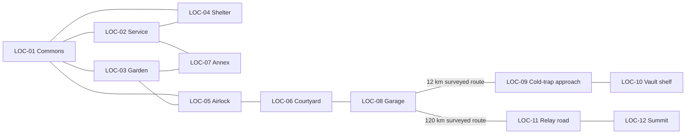

# EN_Malapert Summit — EN_Malapert Summit

**Execution prompt · snapshot 27 October 2026 / `ca01433` · Asset family.**


## Assignment

Assemble/finish `EN_MalapertSummit` as the correct reusable world space or modular piece, with playable routes and current anime presentation.

Execute this bounded task, integrate it with the current project and produce the acceptance evidence below. First reconcile the snapshot with current files; reuse already approved work and complete the real remaining gap.


## Mandatory shared context

Read [02_SHARED_CONTRACT.md](02_SHARED_CONTRACT.md), [03_SYSTEM_INTERFACES.md](03_SYSTEM_INTERFACES.md), [04_CURRENT_STATE.md](04_CURRENT_STATE.md), [05_ACCEPTANCE_AND_HANDOFF.md](05_ACCEPTANCE_AND_HANDOFF.md). Also read the current [AGENTS.md](../AGENTS.md), [PRODUCTION_HANDBOOK.md](../PRODUCTION_HANDBOOK.md) and newest [HANDOFF.md](../HANDOFF.md) entries. Current locked English-only, faceless plants, anime cast and scientific boundaries override older source wording.


## Inputs to inspect

- [production/ASSET_REGISTRY.csv](../production/ASSET_REGISTRY.csv)
- [production/ART_BIBLE.md](../production/ART_BIBLE.md)
- [production/review/codex_readiness_report.md](../production/review/codex_readiness_report.md)
- [game-design/14_ASSET_PRODUCTION_LIST.md](../game-design/14_ASSET_PRODUCTION_LIST.md)
- [production/manifest/planned_assets.csv](../production/manifest/planned_assets.csv)


## Ownership and dependencies

Own `EN_MalapertSummit` source/runtime asset family, variants, metadata and evidence. Coordinate shared kit/material/character changes with the responsible SYS owner; consumers own campaign logic. Do not edit unrelated models.

Core rendering/import conventions and the owning mission/world interaction contract. Existing geometry may be reused immediately; a genuinely new approved design follows the documented concept/credit gate.


## Detailed work sequence

1. Inspect the current binary/source, approved concept and owning scene requirements. Determine the exact missing function, style state or quality defect; preserve the known-good version until the replacement passes.
2. For a 3 D deliverable, establish size/pivot, texture/geometry budget, UV0/normals/tangents, separate material slots, collision, moving child parts and required grip/interaction anchors with the consuming engineer. Add UV2/light map or LOD data when the agreed rendering/import pipeline requires it. Publish names and import settings before scene integration. For a portrait/UI-only deliverable, publish its texture, layout, licensing and runtime binding contract instead.
3. Block out the canonical footprint, connected locations, player/companion anchors and interaction reach before decorative modelling. Keep camera/door/aisle clearance for all five adult scales.
4. Reuse existing corridor/exterior/solar/prop meshes. Build a coherent snap kit, floor/ceiling/wall/door materials, motivated lights and collision/navigation; do not make 49 imported props stand in for assembled rooms.
5. Place chapter-required machinery and live UI surfaces under the proper owners' asset/interaction contracts. Add stable entry/viewpoint/repair/safety anchors and preserve pressure boundaries.
6. Create the necessary day/dark/fault/occupied states without changing the physical layout or teleporting crew. Earth screen locations are staged backgrounds, not a new playable Earth map.
7. Traverse the route with player/camera/companion positions; test gates, door cancel, save/load and every required return path. Profile the full room lighting/material cost.
8. Handoff a usable scene set, adj ace n cy/anchor map, collision/navigation evidence and the exact asset/socket list consumed by missions.


## Task-specific source and implementation detail

### Current checkpoint

- Registry identity: `EN_MalapertSummit`; recorded status `planned`; category `environment`.
- Source trace: `Blender terrain + PR_MalapertRelay`
- Source notes: first used EX-CH08-S06; summit work site (LOC-12)
- First scene/dependency trace: EX-CH08-S06; intended build method: Blender terrain + PR_Malapert Relay.

### Canonical LOC-12 source

## LOC-12 — Mala pert legacy relay summit

- **Narrative significance:** The lighthouse restores a relationship through actual work.
- **Layout / appearance / landmarks:** 30×20 m secured work platform; Earth dish, local repeater antenna, controller bay, tether anchors, rover parking, Earth viewpoint. It is an authored site near real Mala pert, not a surveyed claim.
- **Connected locations:** LOC-11.
- **Interactable objects:** Controller housing, power isola tor, test point, L/E tuner, checksum terminal.
- **NPC positions:** Kai at housing, Ferreira bracing/checking, Rafi tether/vehicle; Noor/Rao/Mei/Amara remote after lock.
- **Mission / scene usage:** SC-0804–05
- **Puzzles / environmental clues:** P-16; object scans enter acquired evidence only; decorative labels cannot prematurely identify Noor.
- **Exploration:** examine all listed props from the main path; no evidence hidden behind movable crates. Optional close inspection adds a journal image but never blocks progress.
- **Lighting / audio:** Earth view used when fictional geometry permits; no claim of eternal visibility. Dish servo through contact/cabin, final voice carries emotion.
- **Unlock / travers al conditions:** summit_reached and repeaters live.
- **Exit behavior:** return path stays open unless a visible pressure/radiation interlock is active; required companions rejoin at a safe anchor on exit. Use a labelled time card for cruise/airlock transitions, not invisible teleportation.

## Logical base layout

```text
                      LOC-04 Safe Room
                       /            \
          LOC-02 Power/Air ------ LOC-01 Commons
               |                       |       \
          LOC-07 Annex -------- LOC-03 Garden -- LOC-05 Airlock
                                                      |
                                               LOC-06 Courtyard
                                                      |
                                               LOC-08 Garage
```

Both annex connections are sealed service access points and require the same safety flag. An emergency route commons→shelter is always available without a puzzle. The player never has to cross an exposed exterior to reach shelter. Clearances: primary aisles 1.5 m, interact approach 1 m, door openings 1.2 m; camera collision needs no crouch. Mission Table is within 15 seconds of any normal station room at default movement speed.



## Revisit and staging rules

CH01 sparse station and labelled empty trays. CH02 paper bee and pollen records. CH03 sealed old annex, petal and founder ledger. CH04 twelve-descendant tray plus quarantined vault. CH05 fifth mug, new controller crate, cotton cassette, Noor portrait. CH06 eclipse print and charged lamp. CH07 shelter reserve case and exposed-branch fault label. CH08 garden photo and repaired relay status. Props accumulate rather than reset between chapters; only mission-specific hazard controls change state.

No meter-scale model is required for all 120 km. Travers al intervals explicitly show distance and elapsed time to prevent a short drive implying Mala pert is next door. Navigation boundaries are geological slopes or surveyed safety limits; do not use invisible walls without a readable route warning.

### Reference/generation brief (use only if a new or revised asset is actually required)

Last Light Academy EN_Malapert Summit environment concept and modular layout, coherent anime/cel treatment matching installed characters, grounded utilitarian lunar hardware, readable navy/ivory/orange/gold accents, metre-scale adult clearance. Use the canonical footprint and route adj ace n cy quoted in this task. Black lunar sky and hard low-sun shadows outside; motivated practical lighting and pressure-safe enclosures inside. Design functional doors, panels, aisles and interaction bays with editable layers and live-screen surfaces.

### Source and runtime handoff

- Preserve editable source, runtime GLB/scene, embedded or project-policy textures, approved dimensions, material slots, collision, named pivots/sockets and explicit state variants.
- Use existing `production/tools/` helpers and `game/tools/verify_assets.gd` after inspecting their current arguments; historical tool paths/versions are not live facts.
- New character/hero prop designs require the exact 2 D approval before Tripo spending; asset reuse and read-only validation do not create an approval request.


## Required deliverables

- Editable source and actual runtime deliverables in the established project layout.
- A bounded integration fixture or owning-scene hookup, with exact resource/API paths and stable IDs.
- Meaningful task-specific checks, actual execution results and visual/audio evidence where required.
- Updated affected manifests/provenance, and a precise handoff for the next dependent owner.


## Acceptance — demonstrate every applicable item

- Actual runtime import and source/provenance are verified; a filename or download-complete message alone is insufficient.
- Size/pivot/bounds/materials match current spec; collisions, moving parts and interaction sockets are demonstrated separately.
- Review the correct anime style in front/side/back and the owning gameplay context; record what was actually inspected.
- All required entrances, exit locks, routes and anchors are traversable in context.
- No fog/haze/billowing dust or unsupported sky claim; local screen/rover/base viewpoints retain correct rosters.
- Imported modular pieces and a complete connected level are reported as different deliverables.
- Pause, cancellation, duplicate input and save/reload preserve a coherent authoritative state where this task is interactive.
- English captions/text, named icons and assisted input preserve all essential information and story access.
- No unlogged generation, unsupported measured claim, new paid tool, secret, unrelated change or unrequested commit/push.


## Completion report

Use `05_ACCEPTANCE_AND_HANDOFF.md`. Record current HEAD, exact files, input revisions, commands and actual outcomes; identify current versus historical evidence. Mark unexecuted checks explicitly. Update production status only after the concrete deliverables pass the applicable gate. Do not count this prompt file itself as completed implementation.
