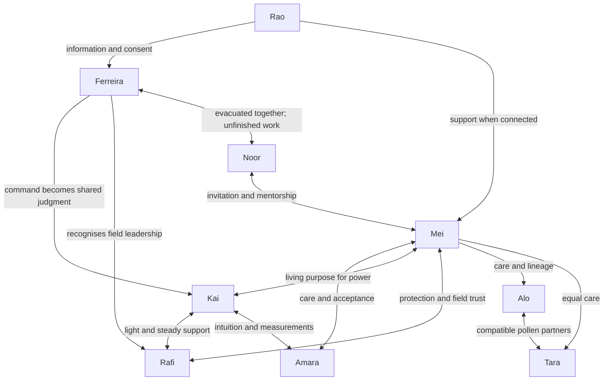

# Character and relationship bible

All ages, personal backgrounds beyond source dialogue, selection procedures and speech details below are newly authored continuity decisions. They are not represented as pre-existing repository facts. Audience age 10–15 does not set astronaut age. Nationalities remain unspecified except Noor's Bangladesh identity and Mei's established family connection to China. All cadets wear the expedition's Bangladesh patch in recognition of the host academy partnership.

## CHAR-KAI — Kai / power and heat

Age 19, qualified junior electrical technician selected for practical systems work and ability to explain equipment. Grew up coping with darkness by keeping lights on; remembers the childhood storm blackout described in Season 1. Wants to be the person who can keep a home functioning. Quick, playful, impulsively generous with power. Strength: sees useful physical connections. Weakness: treats switching off a light as losing control. Afraid of darkness and of admitting an emotional need in a technical team.

Speech: short starts, self-correcting jokes, concrete verbs. “Power’s mine!” matures into “Read every observation.” Never becomes a cold engineer. Relationships: Rafi quietly supports him; Amara makes plans testable; Mei gives saved energy a living purpose; Ferreira models admitting fear. Knowledge: specialist power observations and hand-light location; no special insight into Noor. Visual: orange role tabs, untidy hair, scuffed tool pouch, white/navy suit. Animation signature: checks a switch twice early; checks a labelled plan once later.

Development: SC-0103 concealment → SC-0105 asks for a known returning light → SC-0402 respects a safer route → SC-0503 hears Ferreira name her own fear → SC-0601 names his fear → SC-0605 acts with support → SC-0802 navigates by small lights and known markers. Resolution: remains afraid sometimes and is reliable anyway. Do not write “cured of fear.”

## CHAR-AMA — Amara / atmosphere and measurement

Age 20, junior environmental-systems specialist and instrument cross-check lead. Selected for careful records, not superhuman mathematics. Wants systems and promises to mean what they say. Precise, dryly funny, sometimes impatient with imprecision. Strength: compares observations. Weakness: initially treats uncertainty as personal failure. Fears making a confident claim that harms someone. Role cyan; tidy labels, clipped stylus, stable hand posture; no visual shorthand suggesting emotional coldness.

Speech: exact numbers when useful, short qualifications when evidence is incomplete; occasional deadpan reply. Relationships: values Kai's physical intuition, trusts Rafi's checks, learns patience with Mei's emotional naming. Knowledge: atmosphere diagrams and seed ledger, not the secret gardener. Turning points: stores oxygen early; SC-0301 admits disagreement; SC-0302 uses independent gauge; counts 42 without reducing grief to arithmetic; SC-0803 repeats the check calmly and stays at home to protect everyone. Final resolution: “A measurable success” can include a relationship as well as a meter. She never treats a fallible gauge as proof that science is unreliable.

## CHAR-MEI — Mei / horticulture and living continuity

Age 19, junior plant scientist, initially player-controlled. Selected for sustained care records and willingness to notice things a checklist misses. Grandmother's orchard memories connect manual pollination to family; do not turn this into a claim that all Chinese pollinators disappeared. Wants a garden to be a home rather than a specimen cabinet. Warm, observant, quietly stubborn. Strength: notices living stress. Weakness: mistakes successful care for preventing every ending. Fear: being the person who failed a dependent living thing.

Speech: speaks to plants and people with the same direct care; uses metaphor sparingly. “The garden is not a side system.” Visual green tabs, plant pouch, pencil smudges, seed labels; no flowers exposed to vacuum on costume. Bonds: Kai supplies heat; Amara helps her accept maturity and uncertainty; Rafi protects what matters before it is dramatic; Noor becomes a mentor by consent. Secrets: found packet; no private proof of Noor before the shared investigation. Key scenes SC-0102 naming, SC-0202 pollination, SC-0305 grief, SC-0306 planting descendants, SC-0505 invitation, SC-0803 keeping home. Final resolution: Alo is gone as an individual, present through lineage, petal and community. Mei's care expands rather than hardens.

## CHAR-RAF — Rafi / radiation safety and field operations

Age 20, junior operations specialist with first-response training, not a physician. Chosen for preparation, route discipline and ability to communicate risk. Wants a warning to be heard before it becomes a rescue. Friendly, anxious, makes small jokes. Strength: anticipates failure paths. Weakness: cushions valid warnings with apologies. Fear: missing something preventable or becoming “the person who always worries.” Purple tabs, oversized-looking but correctly fitted helmet shell, visible checklist strap.

Speech: checklists when focused, playful noises when relaxed. His warning is never a joke in the storm. Early teasing concerns harmless checking habits; the game does not reward dismissing safety. Kai accepts his hand light; Mei validates his route decisions; Amara treats his second checks as useful; Ferreira assigns field leadership. Key scenes SC-0103 quiet support, SC-0104 shared warning, SC-0401 leadership, SC-0402 route choice, SC-0703 roll call, SC-0804 tether watch. Final resolution: speaks clearly without an apology; his careful route brings everyone back.

## CHAR-FER — Commander Ferreira / expedition commander

Approximate age 40 s; exact birthday unnecessary. She was Expedition Zero’s youngest engineer in 2034; experienced commander in 2046. Earth-based through Dec 8 departure; travels Dec 8–12; Aurora Dec 12 onward; rover Apr 8–Apr 10. Never appears in two physical places. Calm, clipped, expects competence, capable of warmth. Motivation: finish a biologically meaningful expedition without allowing pride to override retreat rules. Fear: another evacuation interpreted as abandonment. Strength: safe decisions under uncertainty. Weakness: hides emotional context behind procedure.

Knows Noor survived, founded the Academy and left the seed legacy. She lets the cadets discover N.'s personal story, as the season describes, while supplying every safety diagram immediately. She does not confess her Expedition Zero role in Chapter 3; the engineer voice is only a clue. Chapter 4's inscription and her silence lead to the Chapter 5 confession. She never invents a death or hides an operating procedure. Before the reveal, optional questions can confirm every crew member returned without identifying the anonymous writer. Her reluctance concerns guilt, and Chapter 5 acknowledges the cost of withholding that personal context.

Speech: concrete flight instructions, pauses before admissions. Visual: same suit family, worn commander tab and older engineering patch; civilian duty layer at Earth console. Relationships: young-team trust becomes reciprocal; Noor is a former colleague she helped evacuate, not a missing person or romantic subplot. Scene arc: drills from Earth → supplies repair information → travels on relief flight → confesses involvement and guilt → supports Kai → yields operational command → joins final repair because she knows hardware and holds command responsibility. Ending accepts that Noor and cadets share authorship of success.

## CHAR-RAO — Rao / Earth flight controller

Adult; exact age and nationality unspecified. Friendly counterpoint to Ferreira. Background in mission support and classroom outreach. Motivation: keep useful information moving without taking local agency away. Fear: a crew feeling unsupported when radio silence arrives. Strength: concise hints, humour and consent handling. Weakness: may over-explain when worried; self-corrects. Speech friendly, one practical observation at a time. Visual headset, simple Earth control desk; no second Earth environment needed.

Knows Noor survived as part of support roster; knows the seed legacy but keeps the cadets’ discovery private. Receives her permission before CH05 identity announcement. Remains Earth-based throughout and covers Ferreira's transit watch. Available only when communications path exists; after December local companions supply hints during Earth outages. Key scenes SC-0101 welcome, SC-0104 drill hint, SC-0501 remote greeting, SC-0505 consented reveal, SC-0805 final link. Final resolution is a working network that supports rather than commands every action.

## CHAR-NOO — Dr. Noor Rahman / gardener N.

Bangladeshi botanist, adult in 2034 and older in 2047; no exact age needed. Left two dry mustard seeds and twelve distinct vault specimens. After returning to Bangladesh she founded Last Light Academy, named after Expedition Zero’s last sunset, so new crews could finish her work. Survived boarding, with Ferreira's help. Quietly follows every mission report forwarded by Rao, letting the cadets discover her seed legacy before the Chapter 5 introduction. Her hesitation is social/emotional, not incapacity or a medical diagnosis. Motivation: let the living work continue without making young colleagues carry her disappointment. Fear: becoming the symbol of another failed garden. Strength: patient care and honesty about incomplete work. Weakness: withdrawal makes help feel distant.

Speech intimate, economical, specific to plants. Old recordings sign N.; post-reveal N. is a familiar signature. No puzzle asks the player to force consent. Visual Earth portrait with plant-filled work corner; rooftop finale, modest practical clothes. Not a hologram secretly on the Moon. Relationships: Ferreira carried her home, Mei invites her back into the work, all cadets contribute reports. Knowledge: receives only transmitted reports; after February blackout has no real-time insight until relay restores. Key scenes voice SC-0106, records CH02–04, consent CH05, text CH06, final log CH07, voluntary voice CH08. Resolution: chooses to answer in her own name, sees cotton alive and recognises shared accomplishment.

## CHAR-ALO — Alo / first mustard flower

Selected self-incompatible, rapid-cycling Brassica rapa cultivar; named আলো, light. Plant personality is conveyed by stylised facial animation, not dialogue or biological sentience. Needs care; has no human secrets or knowledge. Visual: recognisable purple stem, four-petalled yellow mustard flowers, stylised eyes; no cotton-like spherical head as botanical reference. Any pitch depiction is a style reference; production art must follow field mustard botany. States: seed, sprout, bud, bloom, pollinated, pod-bearing, mature-dry, archived petal/lineage. No natural revival after harvest. Emotional function: makes resource choices personal and teaches continuation through seeds. Reactions communicate stress without implying radiation immunity. SC-0106 and SC-0305 are the main turning points. Finale shows descendants, clearly named as such.

## CHAR-TAR — Tara / partner and indoor reference

Second compatible individual from packet; তারা means star. Same botanical model family, green stem, distinct label and subtle leaf silhouette. Reference location lets the expedition compare environments. Needs equally careful care, and contributes pollen to Alo's42 harvested seeds. No voice, fears or secrets; stylised reactions match plant states. Her own later harvest is recorded in routine care without inventing a second fixed seed count or mixing it with the founder ledger. Resolution: lineage credits read Alo × Tara, never erase the partner to celebrate one mascot.

## Knowledge timeline

| Character | CH01 | CH02 | CH03 | CH04 | CH05 | CH06 | CH07 | CH08 |
|---|---|---|---|---|---|---|---|---|
| All cadets | Packet N.; old bloom message | Earlier trial ended; engineer voice resembles Ferreira | Frozen seedlings, map and N.R.; Ferreira supplies safety diagrams | V12 vault; inscription says ask Ferreira | Signed identity Noor; alive, Academy founder; reviews every report | Known Noor sends text; eclipse data | Full last log; external uplink failure; route safety clear | Dual link restores voice; complete legacy |
| Ferreira | Old failure, Noor survival/founder and seed legacy known | Knows link, allows personal discovery | Shares technical safety notes; no personal confession | Vault inscription leads to silence and later confession | Names Noor with permission; explains own avoidance | Locally supports Kai | Gives cadets operational lead; knows bypass | Repairs controller as physical expedition member |
| Rao | Knows Noor is founder; passes reports | Sees sent fragment | Shares public safety info | Supports Ferreira after inscription | Receives permission, announces living reviewer | Routine Earth support | Last transmitted warning; then no telemetry | Receives restored checks |
| Noor | Sees transmitted bloom report after contact returns; never watches during blackout | Receives pollination report | Receives harvest 42 and map report | Vault recovered report arrives | Consents to identification, replies to invitation | Sends known-sender eclipse memory | No live observation after blackout; final log is historical | Learns outcome from restored telemetry and voice |
| Alo/Tara | No propositional human knowledge | No puzzle-solving minds | Biological stages only | Descendants carry lineage, not memories | Same | Same | Same | Same |

Optional early questions never reveal a false death. They may confirm all crew returned without connecting the anonymous packet. Full names in public evidence are shown at CH05 in the main path; free journal search is local and contains only acquired pages. This is pacing through which documents are recovered, not a claim that historical information is universally secret.

## Relationship chart

For exact spoken words see [dialogue master](11_DIALOGUE_MASTER.md). For physical presence see [timeline](03_STORY_TIMELINE.md). Optional conversations do not advance knowledge flags or replace mandatory revelations.
