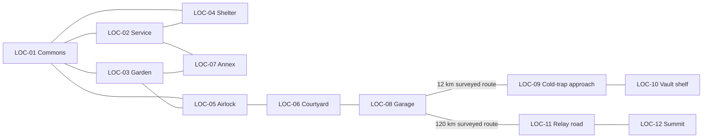

# World and level design

Metric sizes are layout budgets for later greyboxing, not surveyed lunar architecture. Every route is authored. One compact station is revisited; neither an open-world lunar map nor a separate Earth playable level is required.

## LOC-01 — Aurora commons / Mission Table

- **Narrative significance:** The expedition’s heart; uncertainty is discussed here.
- **Layout / appearance / landmarks:** 22×12 m common room; table at centre, Earth screen north, lockers west, galley east, greenhouse view south. Four seats become five after December.
- **Connected locations:** LOC-02,LOC-03,LOC-04,LOC-05.
- **Interactable objects:** Table, role plaques, charter, recorder dock, globe diagram, camera screen, dedication board.
- **NPC positions:** Present off-duty cadets use four table anchors; Ferreira screen before arrival, fifth seat after. Rao/Noor screen only.
- **Mission / scene usage:** SC-0101,SC-0105,SC-0203,SC-0206,SC-0502–05,SC-0603–04,SC-0701,SC-0705–06
- **Puzzles / environmental clues:** P-02,P-09,P-10,P-12; object scans enter acquired evidence only; decorative labels cannot prematurely identify Noor.
- **Exploration:** examine all listed props from the main path; no evidence hidden behind movable crates. Optional close inspection adds a journal image but never blocks progress.
- **Lighting / audio:** Warm practical lighting, fan bed, Earth a small low-angle presence; no constant dramatic music.
- **Unlock / traversal conditions:** Always after arrival; special panels unlock by mission.
- **Exit behavior:** return path stays open unless a visible pressure/radiation interlock is active; required companions rejoin at a safe anchor on exit. Use a labelled time card for cruise/airlock transitions, not invisible teleportation.

## LOC-02 — Power and atmosphere service rooms

- **Narrative significance:** Makes invisible survival systems legible.
- **Layout / appearance / landmarks:** Two adjacent 6×5 m rooms off commons: power west, air east, protected trunk between; glass partitions allow supervision. No cable maze.
- **Connected locations:** LOC-01,LOC-04,LOC-07.
- **Interactable objects:** Battery jar, oxygen tank, electrolyser model, manual pressure taps, garden spur valve, F2 panel, hand light.
- **NPC positions:** Kai at west panel, Amara east; Rafi at safe-side clamp when assigned.
- **Mission / scene usage:** SC-0103,SC-0204–05,SC-0301–02,SC-0601–02,SC-0605
- **Puzzles / environmental clues:** P-04,P-05,P-11,P-12; object scans enter acquired evidence only; decorative labels cannot prematurely identify Noor.
- **Exploration:** examine all listed props from the main path; no evidence hidden behind movable crates. Optional close inspection adds a journal image but never blocks progress.
- **Lighting / audio:** Cool readable work light; equipment sounds differentiated but captions never require hearing them.
- **Unlock / traversal conditions:** Always; annex camera/hatch safing in active M-0301 may read leak_sealed_pending. Physical annex entry in the following mission requires committed leak_sealed and its pressure/suit checks.
- **Exit behavior:** return path stays open unless a visible pressure/radiation interlock is active; required companions rejoin at a safe anchor on exit. Use a labelled time card for cruise/airlock transitions, not invisible teleportation.

## LOC-03 — Garden room and external Alo chamber

- **Narrative significance:** A test facility becomes a home and memorial.
- **Layout / appearance / landmarks:** 12×8 m room; indoor Tara bay left, external pressurised cassette beyond south viewing wall, quarantine glovebox right, seed archive near exit; 1.5 m clear aisles.
- **Connected locations:** LOC-01,LOC-05,LOC-07.
- **Interactable objects:** Alo/Tara ports, moisture probe, mature pods, counting tray, petal sleeve, lineage board, cotton cassette, vault glovebox.
- **NPC positions:** Mei at care bench; Amara beside monitor in harvest/finale; companions remain outside aisles.
- **Mission / scene usage:** All planting, pollination, harvest, vault-opening and final-garden scenes.
- **Puzzles / environmental clues:** P-01,P-03,P-06,P-08,P-15,P-16; object scans enter acquired evidence only; decorative labels cannot prematurely identify Noor.
- **Exploration:** examine all listed props from the main path; no evidence hidden behind movable crates. Optional close inspection adds a journal image but never blocks progress.
- **Lighting / audio:** Growth lamps warm magenta-white with neutral inspection mode; soft fans, water clicks. External flowers never in open vacuum.
- **Unlock / traversal conditions:** Always; harvest and vault tools gated by their mission.
- **Exit behavior:** return path stays open unless a visible pressure/radiation interlock is active; required companions rejoin at a safe anchor on exit. Use a labelled time card for cruise/airlock transitions, not invisible teleportation.

## LOC-04 — Safe Room

- **Narrative significance:** Preparation physically surrounds the crew.
- **Layout / appearance / landmarks:** 8×6 m regolith-shielded core connected to commons and service rooms; five seats, perimeter water panels, indexed crate rails, central seed latch.
- **Connected locations:** LOC-01,LOC-02.
- **Interactable objects:** Hatch, roll-call board, water wall valves, four bundle slots, archive speaker, protected reserve latch.
- **NPC positions:** Four cadet seats in CH01; fifth Ferreira seat in CH07. No wandering during exposure.
- **Mission / scene usage:** SC-0104–05,SC-0702–04
- **Puzzles / environmental clues:** P-02,P-13,P-14; object scans enter acquired evidence only; decorative labels cannot prematurely identify Noor.
- **Exploration:** examine all listed props from the main path; no evidence hidden behind movable crates. Optional close inspection adds a journal image but never blocks progress.
- **Lighting / audio:** Low amber guide lights, readable telemetry; intimate dry voices; no claustrophobic camera squeeze.
- **Unlock / traversal conditions:** Always; exposure lock restricts exterior until two safe readings.
- **Exit behavior:** return path stays open unless a visible pressure/radiation interlock is active; required companions rejoin at a safe anchor on exit. Use a labelled time card for cruise/airlock transitions, not invisible teleportation.

## LOC-05 — Airlock and sealed transfer vestibule

- **Narrative significance:** Connects scientific touch with habitat safety.
- **Layout / appearance / landmarks:** 8×4 m double-door vestibule; suit lockers, bench, sealed carrier pass-through and glove-port access to Alo; independent pressure interlock.
- **Connected locations:** LOC-01,LOC-03,LOC-06.
- **Interactable objects:** Pressure controls, suit checks, pollen carrier, brush tips, door cycle.
- **NPC positions:** One active cadet at tools, companion at checklist; doors never trap an idle NPC.
- **Mission / scene usage:** SC-0202,SC-0401,SC-0501,SC-0801
- **Puzzles / environmental clues:** P-03 and generic EVA protocol.; object scans enter acquired evidence only; decorative labels cannot prematurely identify Noor.
- **Exploration:** examine all listed props from the main path; no evidence hidden behind movable crates. Optional close inspection adds a journal image but never blocks progress.
- **Lighting / audio:** Pump sound only while cycling; text states SEALED / EQUALISING / SAFE TO OPEN.
- **Unlock / traversal conditions:** Exterior access after suit/seal checks and current route safety pass; pollen pass-through available earlier.
- **Exit behavior:** return path stays open unless a visible pressure/radiation interlock is active; required companions rejoin at a safe anchor on exit. Use a labelled time card for cruise/airlock transitions, not invisible teleportation.

## LOC-06 — Aurora mast courtyard

- **Narrative significance:** Shows why power and terrain matter.
- **Layout / appearance / landmarks:** 120 m navigable apron around habitat, twin solar masts and Alo’s protected exterior housing; rail at rim viewpoint; pad path visibly marked.
- **Connected locations:** LOC-05,LOC-08.
- **Interactable objects:** Mast status, terrain-view binocular camera, exterior chamber service label, route markers.
- **NPC positions:** At most two suited cadets for inspection; others represented by local radio.
- **Mission / scene usage:** CH01 optional mast survey; CH04 and CH08 departure transitions.
- **Puzzles / environmental clues:** No extra mandatory puzzle; P-02 draws power status here.; object scans enter acquired evidence only; decorative labels cannot prematurely identify Noor.
- **Exploration:** examine all listed props from the main path; no evidence hidden behind movable crates. Optional close inspection adds a journal image but never blocks progress.
- **Lighting / audio:** Sharp low Sun, black sky, long shadows; suit/chassis conduction only. No wind or fog.
- **Unlock / traversal conditions:** Suit check and no active particle-exposure lock.
- **Exit behavior:** return path stays open unless a visible pressure/radiation interlock is active; required companions rejoin at a safe anchor on exit. Use a labelled time card for cruise/airlock transitions, not invisible teleportation.

## LOC-07 — Expedition Zero service annex

- **Narrative significance:** A known isolated space holds an unknown personal past.
- **Layout / appearance / landmarks:** 10×6 m lower service annex reached through a hatch from service corridor; two frozen trays, certified isolation boundary, viewing port and sealed map pouch.
- **Connected locations:** LOC-02,LOC-03.
- **Interactable objects:** N.R. hatch, old seedling chart, map pouch, legacy loop valve photograph.
- **NPC positions:** Rafi safety anchor, Mei examining trays, Amara pressure check; suits required until thermal/air conditions safe.
- **Mission / scene usage:** SC-0303–04
- **Puzzles / environmental clues:** P-06 evidence prerequisites; safety gate uses P-05 result.; object scans enter acquired evidence only; decorative labels cannot prematurely identify Noor.
- **Exploration:** examine all listed props from the main path; no evidence hidden behind movable crates. Optional close inspection adds a journal image but never blocks progress.
- **Lighting / audio:** Headlamp-led detail, transmitted metal creaks; frozen seedlings not horror decorations.
- **Unlock / traversal conditions:** leak_sealed, feed isolated, pressure differential zero, suit check.
- **Exit behavior:** return path stays open unless a visible pressure/radiation interlock is active; required companions rejoin at a safe anchor on exit. Use a labelled time card for cruise/airlock transitions, not invisible teleportation.

## LOC-08 — Rover garage and landing apron

- **Narrative significance:** Arrivals and departures are deliberate.
- **Layout / appearance / landmarks:** Garage12×9 m with pressure-rated rover bay, cargo rack, external pad 500 m away seen through camera; marked path joins courtyard.
- **Connected locations:** LOC-06,LOC-09,LOC-11.
- **Interactable objects:** Rover, cargo cradle, route board, supply ledger, suit seals, relief locker.
- **NPC positions:** Field team at rover slots; Amara at base handover terminal; Ferreira arrival uses pad camera then airlock.
- **Mission / scene usage:** SC-0401,SC-0501,SC-0801
- **Puzzles / environmental clues:** P-07,P-15 departure checks.; object scans enter acquired evidence only; decorative labels cannot prematurely identify Noor.
- **Exploration:** examine all listed props from the main path; no evidence hidden behind movable crates. Optional close inspection adds a journal image but never blocks progress.
- **Lighting / audio:** Vehicle work lights, interior pump hum; no unsafe walking under a landing plume.
- **Unlock / traversal conditions:** seed_legacy for CH04 trip; route_clear for final trip; arrival scene independent of rover departure.
- **Exit behavior:** return path stays open unless a visible pressure/radiation interlock is active; required companions rejoin at a safe anchor on exit. Use a labelled time card for cruise/airlock transitions, not invisible teleportation.

## LOC-09 — Surveyed cold-trap approach

- **Narrative significance:** Rafi’s cautious route becomes a scientific discovery.
- **Layout / appearance / landmarks:** 12 km authored ridge road represented by three 100 m playable segments plus cruise; approach slopes<=12°, a permanently shadowed side basin, not descent down Shackleton’s full crater wall.
- **Connected locations:** LOC-08,LOC-10.
- **Interactable objects:** Three survey beacons, dry reference plate, sample points, slope sign, return marker.
- **NPC positions:** Rafi field lead/sample operator and Kai driver/systems; Mei and Amara at the base with slope map and local relay.
- **Mission / scene usage:** SC-0402
- **Puzzles / environmental clues:** P-07; object scans enter acquired evidence only; decorative labels cannot prematurely identify Noor.
- **Exploration:** examine all listed props from the main path; no evidence hidden behind movable crates. Optional close inspection adds a journal image but never blocks progress.
- **Lighting / audio:** Light diminishes in discrete terrain occlusion; surface may be below−230°C at selected fictional sample site; vehicle remains thermally controlled.
- **Unlock / traversal conditions:** Rover checks and valid route selected.
- **Exit behavior:** return path stays open unless a visible pressure/radiation interlock is active; required companions rejoin at a safe anchor on exit. Use a labelled time card for cruise/airlock transitions, not invisible teleportation.

## LOC-10 — Cold-trap vault shelf

- **Narrative significance:** Human preparation in a place without sunrise.
- **Layout / appearance / landmarks:** 20×15 m level shelf off surveyed basin route; old marker and small insulated box, two tether anchors; no cavern or maze.
- **Connected locations:** LOC-09.
- **Interactable objects:** Vault V12, outer probe socket, carrier tether, archival survey tag.
- **NPC positions:** Two suited field cadets, one manipulates while the other assists; two cadets remain at base; no Earth-based NPC appears.
- **Mission / scene usage:** SC-0403–04
- **Puzzles / environmental clues:** P-08 field half.; object scans enter acquired evidence only; decorative labels cannot prematurely identify Noor.
- **Exploration:** examine all listed props from the main path; no evidence hidden behind movable crates. Optional close inspection adds a journal image but never blocks progress.
- **Lighting / audio:** Headlamps and instrument illumination; stars visible only when exposure supports them; suit audio.
- **Unlock / traversal conditions:** P-07 ice_survey_pending during active M-0401, or committed ice_survey afterward, plus safe vehicle parking. Discovery at SC-0403 must not wait on the completion flag it helps create.
- **Exit behavior:** return path stays open unless a visible pressure/radiation interlock is active; required companions rejoin at a safe anchor on exit. Use a labelled time card for cruise/airlock transitions, not invisible teleportation.

## LOC-11 — Malapert relay road

- **Narrative significance:** The final trip scales the familiar journey into a commitment.
- **Layout / appearance / landmarks:** 120 km fictional surveyed path, three repair-capable repeater stops, two rest laybys, last summit approach; five short playable segments total~700 m, cruise explicitly compressed.
- **Connected locations:** LOC-08,LOC-12.
- **Interactable objects:** Repeater1/2/3, marker 2 battery bay, slope warnings, turnback zones, cabin supplies.
- **NPC positions:** Ferreira/Kai/Rafi only; home team accessible through authored viewpoint cut, never same-location switch.
- **Mission / scene usage:** SC-0802
- **Puzzles / environmental clues:** P-15; object scans enter acquired evidence only; decorative labels cannot prematurely identify Noor.
- **Exploration:** examine all listed props from the main path; no evidence hidden behind movable crates. Optional close inspection adds a journal image but never blocks progress.
- **Lighting / audio:** Guide lights become meaningful against black terrain; camera comfort options and relaxed cabin sound.
- **Unlock / traversal conditions:** route_clear, all occupants/supplies validated; radios local only before relay repair.
- **Exit behavior:** return path stays open unless a visible pressure/radiation interlock is active; required companions rejoin at a safe anchor on exit. Use a labelled time card for cruise/airlock transitions, not invisible teleportation.

## LOC-12 — Malapert legacy relay summit

- **Narrative significance:** The lighthouse restores a relationship through actual work.
- **Layout / appearance / landmarks:** 30×20 m secured work platform; Earth dish, local repeater antenna, controller bay, tether anchors, rover parking, Earth viewpoint. It is an authored site near real Malapert, not a surveyed claim.
- **Connected locations:** LOC-11.
- **Interactable objects:** Controller housing, power isolator, testpoint, L/E tuner, checksum terminal.
- **NPC positions:** Kai at housing, Ferreira bracing/checking, Rafi tether/vehicle; Noor/Rao/Mei/Amara remote after lock.
- **Mission / scene usage:** SC-0804–05
- **Puzzles / environmental clues:** P-16; object scans enter acquired evidence only; decorative labels cannot prematurely identify Noor.
- **Exploration:** examine all listed props from the main path; no evidence hidden behind movable crates. Optional close inspection adds a journal image but never blocks progress.
- **Lighting / audio:** Earth view used when fictional geometry permits; no claim of eternal visibility. Dish servo through contact/cabin, final voice carries emotion.
- **Unlock / traversal conditions:** summit_reached and repeaters live.
- **Exit behavior:** return path stays open unless a visible pressure/radiation interlock is active; required companions rejoin at a safe anchor on exit. Use a labelled time card for cruise/airlock transitions, not invisible teleportation.

## Logical base layout

```text
                      LOC-04 Safe Room
                       /            \
          LOC-02 Power/Air ------ LOC-01 Commons
               |                       |       \
          LOC-07 Annex -------- LOC-03 Garden -- LOC-05 Airlock
                                                      |
                                               LOC-06 Courtyard
                                                      |
                                               LOC-08 Garage
```

Both annex connections are sealed service access points and require the same safety flag. An emergency route commons→shelter is always available without a puzzle. The player never has to cross an exposed exterior to reach shelter. Clearances: primary aisles 1.5 m, interact approach 1 m, door openings 1.2 m; camera collision needs no crouch. Mission Table is within 15 seconds of any normal station room at default movement speed.



## Revisit and staging rules

CH01 sparse station and labelled empty trays. CH02 paper bee and pollen records. CH03 sealed old annex, petal and founder ledger. CH04 twelve-descendant tray plus quarantined vault. CH05 fifth mug, new controller crate, cotton cassette, Noor portrait. CH06 eclipse print and charged lamp. CH07 shelter reserve case and exposed-branch fault label. CH08 garden photo and repaired relay status. Props accumulate rather than reset between chapters; only mission-specific hazard controls change state.

No meter-scale model is required for all 120 km. Traversal intervals explicitly show distance and elapsed time to prevent a short drive implying Malapert is next door. Navigation boundaries are geological slopes or surveyed safety limits; do not use invisible walls without a readable route warning.
