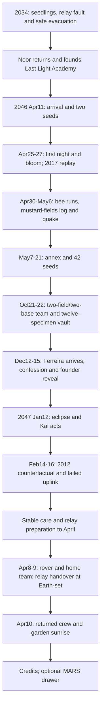
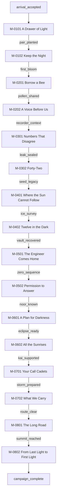
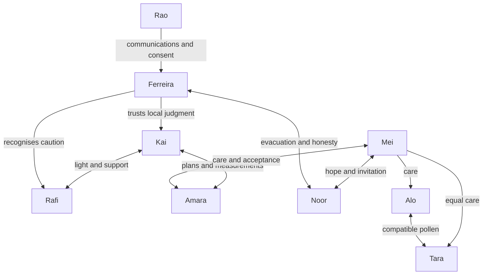
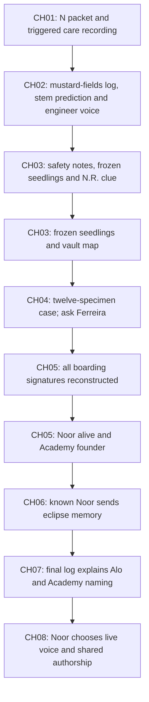
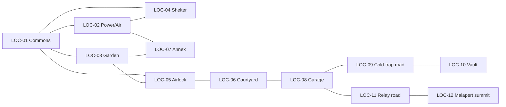
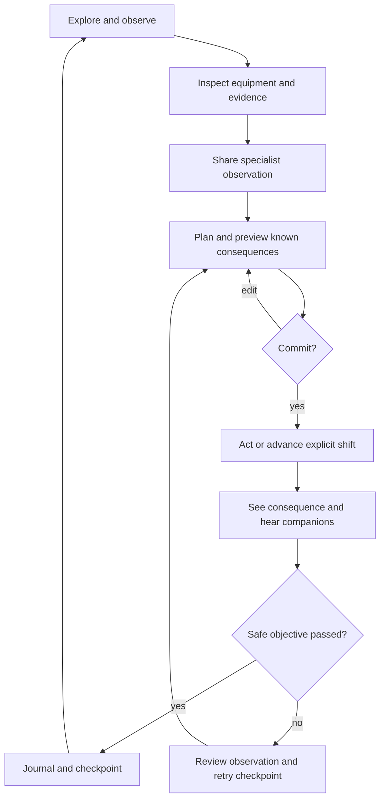
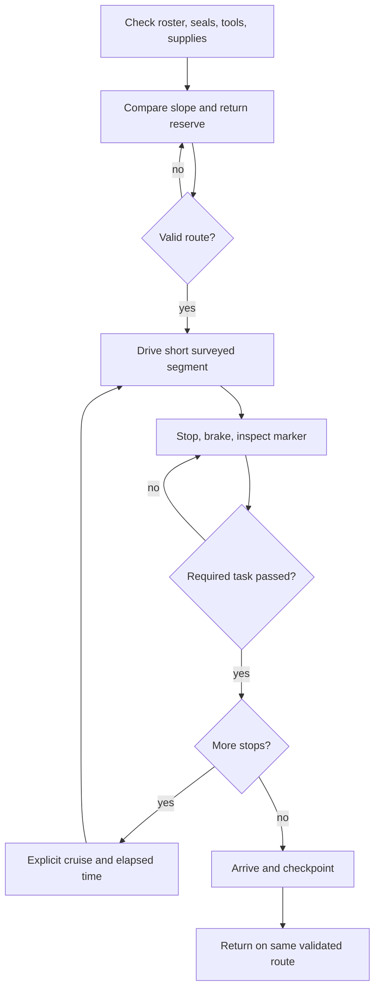
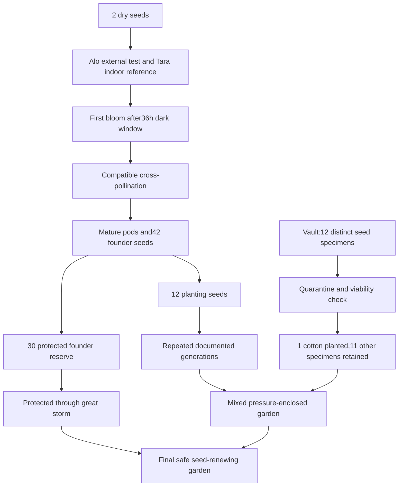
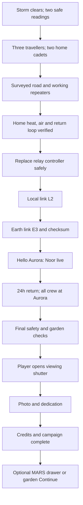

# Story and gameplay flowcharts

IDs agree with mission, scene, puzzle, location and flag documents. Rectangles are required progress unless marked optional. Failure loops restore a safe checkpoint; no failed campaign silently substitutes another plant.

## 1. Entire chronology

## 2. Chapter progression

## 3. Mission dependencies

## 4. Relationships

## 5. Expedition Zero revelation

## 6. World connectivity

## 7. Main gameplay loop

## 8. Rover flow

## 9. Garden progression

## 10. Ending sequence

